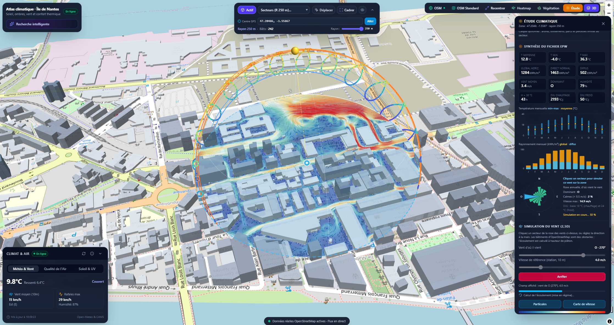

# CONFORT-CLIMAT — Atlas climatique de l'Île de Nantes

Application cartographique 3D qui aide à **comprendre le microclimat d'un quartier en phase d'esquisse** : course du soleil, ombres portées, ensoleillement, écoulement du vent entre les bâtiments et confort thermique (UTCI) des espaces publics.

Elle fonctionne dans le navigateur, à partir de données ouvertes. Les résultats sont des **aides à la conception, qualitatives et comparatives** : ils servent à repérer des tendances (zones à l'ombre, couloirs venteux, places surchauffées) et à comparer des situations, pas à produire un calcul réglementaire.



## Fonctionnalités

Les calculs portent sur un **secteur circulaire de 100 à 250 m de rayon**, placé n'importe où sur la carte.

| Fonction | Ce qu'elle montre |
| :-- | :-- |
| Secteur d'étude | Zone circulaire centrée sur des coordonnées GPS |
| Fichier EPW | Synthèse du climat : températures, rayonnement, rose des vents, degrés-jours |
| Sunpath | Course du soleil en dôme 3D ou diagramme au sol, à toute date et heure |
| Ombres portées | Ombres au sol à l'heure choisie, en direct |
| Soleil du jour | Heures de soleil direct au sol sur une journée |
| Végétation | Arbres et espaces verts d'OpenStreetMap, couverture végétale et canopée |
| Simulation du vent | Accélérations et zones calmes à hauteur de piéton pour une direction donnée (solveur de Boltzmann sur réseau 2D) |
| Confort thermique | Carte de l'indice UTCI à 0,5 m de résolution pour une heure |
| Exports | JSON, CSV horaire et GeoJSON pour Grasshopper / Ladybug, Python ou tableur |
| Recherche intelligente | Assistant IA avec recherche web (clé Gemini nécessaire, optionnelle) |

## Installation

Prérequis : [Node.js](https://nodejs.org) (version LTS).

```bash
git clone https://github.com/Laurent-Lescop/CONFORT-CLIMAT.git
cd CONFORT-CLIMAT
npm install
npm run dev
```

L'application s'ouvre sur <http://localhost:3000>.

Sous Windows, il suffit de double-cliquer sur `lancer-application.bat` (les modules sont installés au premier lancement). Sous Linux ou macOS : `lancer-application.sh`. En cas de blocage de Windows, voir `debloquer-windows.bat` et le [guide d'utilisation locale](GUIDE_UTILISATION_LOCALE.md).

### Clé Gemini (optionnelle)

Seule la *Recherche intelligente* en a besoin. Copiez `.env.example` en `.env` et renseignez `GEMINI_API_KEY`. Le reste de l'application fonctionne sans clé. Le fichier `.env` n'est jamais versionné.

### Scripts

| Commande | Rôle |
| :-- | :-- |
| `npm run dev` | Lance le serveur local (Express + Vite) |
| `npm run build` | Génère les workers MapLibre puis construit l'application |
| `npm run lint` | Vérification TypeScript |

## Documentation

- [Guide d'installation et d'utilisation locale](GUIDE_UTILISATION_LOCALE.md), avec ou sans connexion Internet.
- Tutoriel illustré : [version Markdown](tuto/Tutoriel_Atlas_climatique_Ile_de_Nantes-blog.md), [version Word](tuto/Tutoriel_Atlas_climatique_Ile_de_Nantes.docx) et [version blog](tuto/Tutoriel_Atlas_climatique_Ile_de_Nantes-blog.docx).
- Captures d'écran dans [`tuto/images`](tuto/images).

## Structure du dépôt

```
src/
  components/   interface (carte, panneaux, modales)
  services/     météo, végétation, vent, ombres, confort, Gemini
  utils/        EPW, position du soleil, UTCI, solveur LBM, rendu GL
  workers/      calculs lourds en Web Workers (vent, confort)
  data/         bâtiments et données de l'Île de Nantes
server.ts       serveur local (Express) et relais Gemini
scripts/        génération des bâtiments, correctif MapLibre
public/         données, images, workers MapLibre
tuto/           tutoriel et captures d'écran
```

## Données et sources

- Bâtiments et végétation : © contributeurs [OpenStreetMap](https://www.openstreetmap.org/copyright) (licence ODbL), végétation via l'API Overpass.
- Météo et qualité de l'air en temps réel : [Open-Meteo](https://open-meteo.com), Copernicus Atmosphere Monitoring Service (CAMS).
- Climat de référence : fichier EPW de votre choix, par exemple sur [climate.onebuilding.org](https://climate.onebuilding.org).
- Indice UTCI : polynôme officiel (Bröde et al.) ; température radiante moyenne par un modèle simplifié de type SOLWEIG.

## Limites

- Calcul instantané, sans inertie thermique, sans réflexions entre bâtiments ni évapotranspiration : le confort se lit en écart entre lieux plus qu'en valeur absolue.
- Vent 2D à hauteur de piéton : les bâtiments sont des obstacles pleins, sans profil vertical ni végétation.
- Ombres au sol seulement (pas sur les toits ni les façades).
- Seuls les arbres saisis dans OpenStreetMap sont pris en compte.

## Auteur

Laurent Lescop, ENSA Nantes — CRENAU / AAU (UMR CNRS 1563).

## Licence

[MIT](LICENSE)
